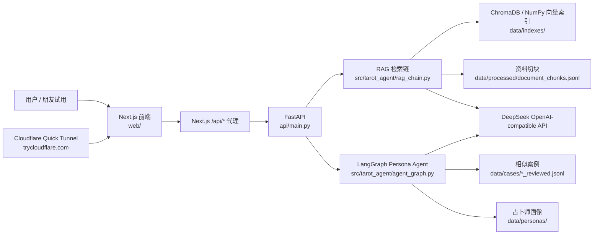
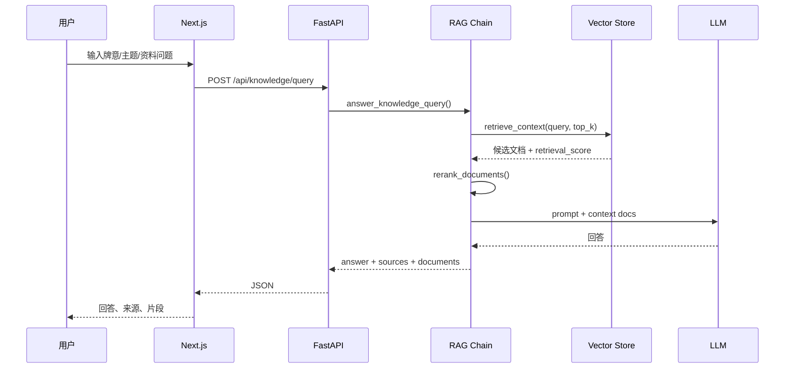
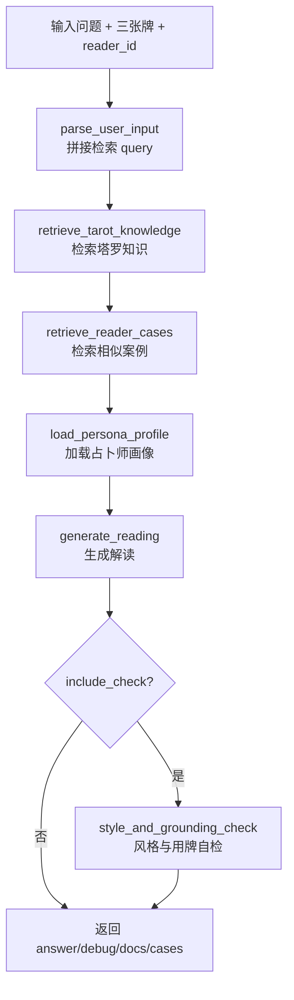
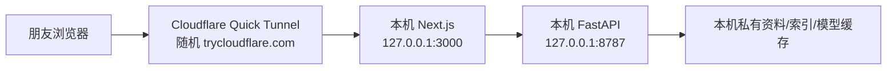

# Architecture

这个项目由本地资料处理、FastAPI 服务、Next.js 前端和 Persona Agent 组成。核心目标不是把塔罗内容写死在 prompt 里，而是让 Agent 在回答前先检索资料和案例，再把来源、牌面和占卜师画像合成到一次解读中。

## 系统总览

## 知识库问答流程

## Persona Agent 流程

## 临时分享链路

`scripts/start_share.ps1` 只把 Next.js 前端暴露给 Cloudflare，不直接暴露 FastAPI。朋友访问公网链接时，请求先到前端，再由前端的 `/api/*` 代理转发到本机 FastAPI。

Cloudflare Quick Tunnel 只适合测试和开发：链接是随机临时地址，不承诺生产稳定性。用完后运行 `scripts/stop_share.ps1` 关闭 tunnel。

## 私有数据边界

- `Doc/`、`Tarotist-*`、`Cards-png/`、`data/indexes/`、`data/processed/` 和模型缓存默认留在本机。
- `.env` 存放 API key，不提交到 Git。
- 面向实习展示时，建议公开代码、架构、截图、评估方法和脱敏样例，不公开原始资料与完整索引。
